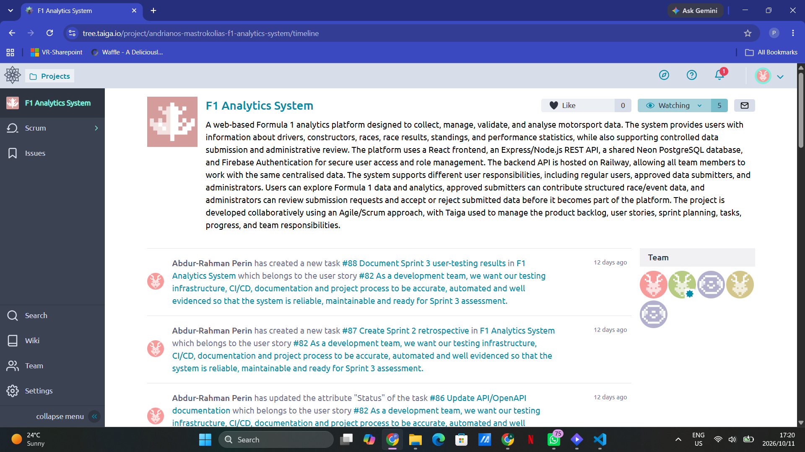
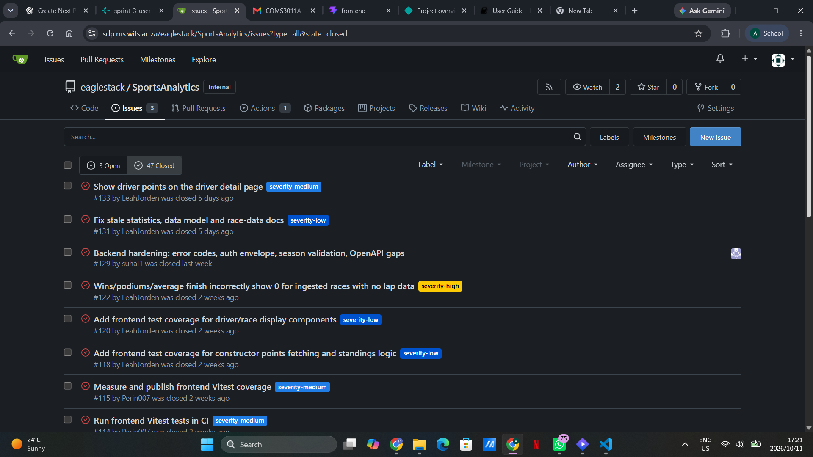

# Project Methodology

This project uses a lightweight Agile/Scrum-style methodology suited to a five-person university team working across frontend development, backend API work, Firebase authentication, PostgreSQL data flows, and data-analysis features. The goal is to keep delivery organised, collaborative, and transparent without introducing unnecessary overhead.

The team’s development process is built around a small number of practical habits: clear task definition, branch-based delivery from `main`, peer review, automated validation, and regular Sprint check-ins. This gives the project enough structure to stay coordinated while remaining focused on implementation and delivery.

## AI Usage

The following AI tools assisted with implementation, review, and documentation:

- **Claude Code — Claude Sonnet 5, Claude Opus 4.5, Claude Opus 5:** code generation and code review.
- **Claude Web — Claude Sonnet 5:** code generation during development.
- **ChatGPT Web — GPT-5.6 Sol:** frontend/backend code generation, integration, and debugging.
- **OpenAI Codex — Default model selection:** code and documentation assistance, repository inspection, and validation through VS Code.
- **GitHub Copilot Chat — Auto model selection:** in-editor assistance and documentation work in VS Code.

## 1. Core workflow

The project uses a simple and consistent workflow:

1. define the work in Taiga as a user story, task, or sprint item
2. pull the latest `main`
3. create a `feature/...` branch from `main`
4. implement the work in a focused branch
5. run the relevant validation checks
6. push the branch and open a Pull Request in Gitea
7. complete peer review before merge
8. merge approved work into `main`
9. review Sprint progress and capture feedback in the next planning cycle

This is the default delivery model for the project. The team keeps work organised through Taiga for planning and tracking, and through Gitea for implementation, review, and merge traceability.

## 2. Sprint planning and backlog

The team uses short delivery cycles to keep the project moving steadily and to maintain clarity around priorities. Sprint planning is used to identify the most important work for the upcoming cycle, break it into manageable tasks, and assign ownership where practical.

The Sprint backlog is maintained in Taiga, where product and Sprint work are visible as user stories, tasks, and progress updates. Each item should describe a clear goal, expected outcome, and any relevant technical notes so the team can move from planning to implementation without confusion.

This project is not large enough to justify a heavy formal process, but it does benefit from a visible backlog, clear ownership, and a regular review of progress. That makes planning practical and keeps the team aligned on what is being delivered next.

## 3. Work Tracker — Taiga

Taiga provides the project-management layer for the team’s Agile/Scrum work. It is used to record the Sprint, backlog, user stories, tasks, ownership, and progress/status history that keep planning visible and accountable.

A well-formed Taiga item should include:

- the task or user story being addressed
- the expected outcome or acceptance criteria
- any relevant technical context or constraints
- the owner or team member responsible for the work

This makes the team’s planned work visible from Sprint planning through implementation and review. It supports traceability for priority setting, ownership, and progress across the project.

## 4. Bug / Issue Tracking — Gitea

Gitea provides the development and version-control traceability layer. It records the work as it moves from a feature branch into implementation, review, and merge. This is where the team works with `main`, `feature/...` branches, commits, Pull Requests, and code review.

Gitea is used for:

- feature branches
- meaningful commits
- Pull Requests
- peer review
- CI workflow recognition and validation evidence
- merge history and repository-level traceability

The repository includes `.gitea/ISSUE_TEMPLATE/bug_report.md` and the
[Gitea Issue Tracking screenshot](#gitea-issue-tracking), which shows actual
open and closed issue activity. Sprint retrospectives also cite concrete fix
and feature pull requests, including Sprint 2 PRs #66, #69, #76, and #79 and
Sprint 4 PRs #130 and #142. These records show issue-tracker use and selected
delivery examples, not that every project task or bug was tracked. See
[Git Workflow](git-workflow.md) and the [Sprint 2 Retrospective](retrospectives/sprint2-retrospective.md).

Together, Taiga and Gitea support the project’s planning and implementation
workflow; representative screenshots and repository artefacts are retained
here.

## Project Tracking Evidence

The following screenshots provide retained evidence of the project tools being used during development.

### Taiga Work Tracking

*Taiga project activity showing user stories, numbered tasks, progress updates and team participation during development.*

The screenshot supports the documented use of Taiga for Scrum/project tracking, user stories, tasks, and sprint work. Its visible activity also shows ownership and progress updates.

### Gitea Issue Tracking

*Gitea issue tracker showing open and closed issues, severity labels and concrete implementation/testing tasks.*

The screenshot demonstrates actual issue-tracker use, including open and closed issues, issue numbers, severity labels, bugs, testing tasks, and implementation work. At capture time it showed 47 closed issues and 3 open issues; it does not imply every project bug was recorded there.

## 5. Feature branches and focused delivery

The team works in short-lived `feature/...` branches created from `main`. This keeps work isolated, reviewable, and easier to merge without disturbing the main branch.

Each feature branch is intended to be focused on a specific problem or deliverable. Team members keep changes scoped to the agreed task and avoid mixing unrelated refactoring or exploratory work into the same branch. This approach is especially useful for a project that spans multiple technical areas and where several members may be working concurrently.

## 6. Meaningful commits

The team uses meaningful, readable commits to maintain a clear history of work. Commit messages are expected to describe the purpose of the change rather than generic status updates.

This supports maintainability and makes it easier for teammates to review the project history. It also helps when debugging issues or reviewing a feature after the fact.

## 7. Pull Requests and peer review

Pull Requests are the key integration step for work moving from a feature branch into `main`. The team uses them to review scope, verify correctness, and confirm that a change is appropriate before it is merged.

Peer review is a standard part of the process. Reviewers check whether:

- the implementation matches the agreed task
- the change is appropriately scoped
- the logic is sound
- validation has been run
- the code remains understandable and maintainable

This keeps quality high while supporting a collaborative development environment. For a five-person project, this is a practical balance between speed and technical oversight.

## 8. Automated validation and testing

The frontend and backend projects both include automated validation scripts. The frontend includes linting, a TypeScript/Vite build, Vitest UI tests with V8 coverage, Firestore rules tests, and a Playwright login-page smoke suite. The backend includes TypeScript build validation and Vitest tests with V8 coverage, including isolated PostgreSQL submission integration tests when `TEST_DATABASE_URL` is supplied.

These checks are part of the team’s expected workflow for validating implementation work before merge. In practice, they help catch issues early and give reviewers clear evidence that a change has been exercised in the relevant project layer.

The team uses automated validation as a normal part of delivery rather than as an optional extra. This is particularly important for a project with both UI work and backend/data work, where a change in one area can have knock-on effects in another.

## 9. CI and automated project checks

The repository includes a Gitea CI workflow in `.gitea/workflows/ci.yml`. It is configured to run when changes are pushed to `main` and when a pull request targets `main`.

The workflow contains four validation jobs, followed by a backend deployment job:

- frontend lint, build, Vitest coverage, Firestore emulator rules tests, and Playwright Chromium smoke tests
- backend build and coverage tests against a disposable local PostgreSQL test database
- fresh PostgreSQL database creation from `database/schema.sql`, development seed loading, and `database/verify_schema.sql` checks
- MkDocs strict documentation build
- Railway backend deployment after all four validation jobs succeed, only for pushes to `main`

Node jobs use Node 22; the frontend job also installs Java 21 for the Firestore emulator. Frontend and backend coverage reports are uploaded with `continue-on-error: true`, so an artifact-service failure does not itself fail a validation job. Build, test, and database checks remain required. Railway deployment uses repository secrets and is skipped for pull requests. The production application is live on Azure, with its backend API on Railway and PostgreSQL on Aiven.

This gives the team automated project checks for branch delivery and pull-request review. See [Testing](testing.md) and [Local Setup](setup.md) for the commands, prerequisites, and limitations of local validation.

## 10. Stakeholder Interaction

The project is not built in isolation. Tutor or stakeholder feedback is treated as a source of project direction and requirement clarification. When feedback is received, it is translated into concrete technical decisions, backlog items, or issue updates so that the team can act on it consistently.

Recorded stakeholder and external-user evidence includes the
[Sprint 2 stakeholder response](user-testing/sprint2-user-testing.md#stakeholder-feedback-summary)
and [Sprint 2](user-testing/sprint2-user-testing.md) and
[Sprint 3](user-testing/sprint3-user-testing.md) external testing. The
[Sprint Evidence](sprint-evidence.md) page links retained meeting PDFs but
explicitly limits them to meeting occurrence/attendance evidence; it does not
reconstruct stakeholder discussions. Sprint 1-specific stakeholder feedback
is not established by the retained local evidence.

## 11. Sprint review and retrospective

Sprint reviews are used to check progress against the planned work, identify what was completed, and confirm the team’s priorities for the next cycle. The project team reviews what was achieved, what changed, and whether any work needs to be adjusted based on new information or technical constraints.

Retrospectives are used to reflect on what went well, what caused friction, and what should improve in the next Sprint. This is particularly useful in a project with multiple workstreams, where communication, task ownership, and integration work are just as important as the code itself.

The [Sprint 1 retrospective](retrospectives/sprint1-retrospective.md) and [Sprint 2 user-testing evidence](user-testing/sprint2-user-testing.md) record the early project reflection and feedback. The [Sprint 3 delivery evidence](retrospectives/sprint3-evidence.md) and [Sprint 4 delivery evidence](retrospectives/sprint4-evidence.md) summarize later implementation and sprint meetings, grouping work by its recorded chronology and attribution.

The goal is not to create bureaucracy, but to keep the team aligned and to improve the process over time as the project matures.

## 12. Evidence and traceability

The methodology is demonstrated through the project’s normal evidence and delivery artefacts:

Taiga evidence:

- Sprint planning and Sprint backlog
- user stories and tasks
- ownership and status/progress tracking
- backlog and milestone traceability

Gitea evidence:

- feature branches
- meaningful commits
- Pull Requests
- peer review
- CI workflow/checks

Technical evidence:

- frontend lint and build
- backend build and tests
- MkDocs strict build
- deployed documentation site

Process evidence:

- stakeholder and tutor feedback
- Sprint review
- retrospective

These artefacts make the team’s process visible and maintainable. Together they provide traceability from planned work through implementation, review, and merge, which is essential for a collaborative project with several concurrent workstreams.

## 13. Summary

This project uses a practical, lightweight Agile/Scrum-style process designed for a small university team. The team works from `main` using `feature/...` branches, plans and tracks work in Taiga, reviews changes through Pull Requests in Gitea, validates with automated checks, and reviews progress through Sprint activities.

This methodology is intentionally lightweight: it provides structure without formal overhead, supports rapid iteration, and matches the realities of building a Formula 1 sport analytics application across frontend, backend, Firebase, and data workflows. It is a realistic and appropriate model for this project and its team size.
