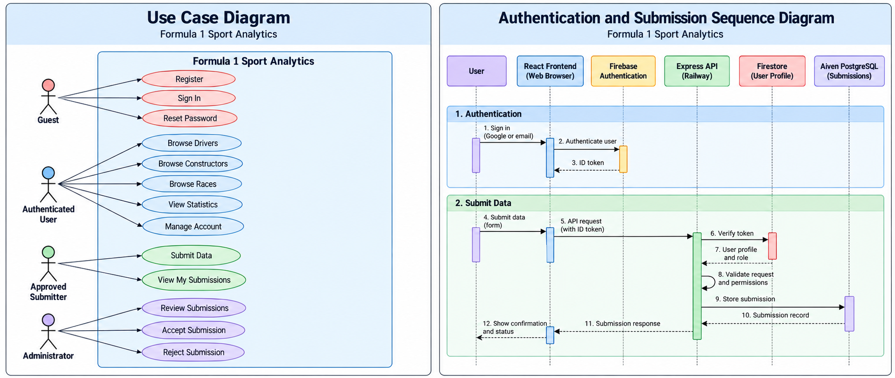

# UML and System Diagrams

These diagrams provide simplified views of the implemented Formula 1 Sport Analytics system at Sprint 3.

## Use Case and Authentication / Submission Sequence

The left side shows the main application roles and their available actions. The right side shows how authentication and submissions move through the React frontend, Firebase authentication and role/profile checks, the Express API, and Aiven PostgreSQL.