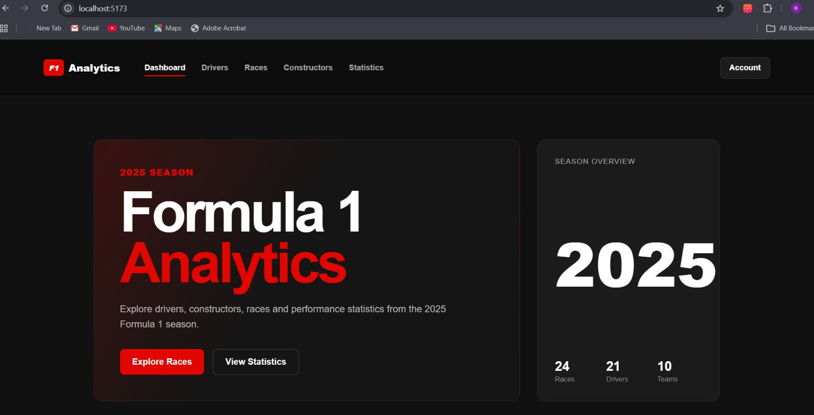
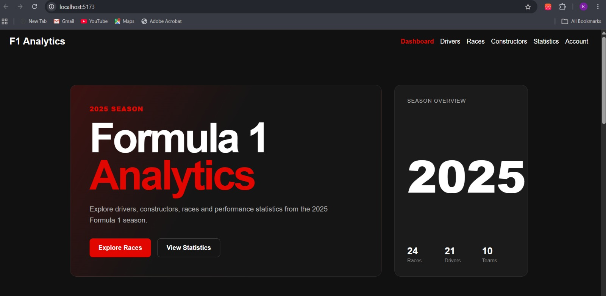
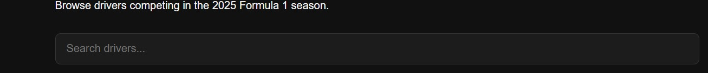
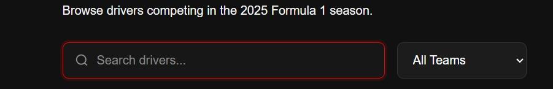

# Sprint 2 User Testing Evidence

This page records verified Sprint 2 user-testing evidence for the SportsAnalytics frontend. It uses only repository facts and the local Google Form CSV that was uploaded during the Sprint 2 review process.

The results and screenshots below are retained Sprint 2 evidence. The raw response CSV is not committed in the current repository, so the published response counts and averages cannot be independently recalculated from this checkout. Later Sprint 3/4 changes and automated tests do not constitute additional recorded user feedback.

## Sprint Meeting Summary

Sprint 2 meetings concentrated on moving beyond the initial prototype and making the application work with more realistic data and workflows. Jolpica ingestion, caching and PostgreSQL read models were introduced so that Formula 1 information could be sourced and queried more reliably. The team also strengthened the submission review and history process, role rules and recoverable account-deletion behaviour, while expanding the statistics available to users, including points, consistency, grid-gain and race-result fallbacks. User testing became an important part of the sprint, and the interface was adjusted in response to the feedback collected. Testing also matured substantially through increased backend coverage, Firestore rules testing, Playwright login checks and CI integration.

## Testing window

- Responses were collected between 11 and 13 September 2026.
- Total responses: 7
- External users: 6
- Stakeholder response: 1

The stakeholder row was identified internally as Risuna Ntimana and is reported separately below. External-user results are aggregated only and do not include names.

## External-user-only results

The following averages are calculated from the 6 external-user responses only.

| Question | External-user average |
| --- | --- |
| How easy was it to navigate around the F1 Analytics website? | 4.83 / 5 |
| How would you rate the overall design and appearance of the website? | 4.83 / 5 |
| How easy was it to find a specific driver and view their information? | 4.67 / 5 |
| How easy was it to find a race and view its information and results? | 4.67 / 5 |
| Did the colours, images, circuit layouts and overall F1 theme make the website visually appealing and easy to understand? | 5.00 / 5 |

### External-user qualitative feedback

Positive themes that appeared across the external-user responses:

- The site was considered easy to navigate.
- The overall design and visual style were seen as polished and appealing.
- The drivers, constructors, races, and statistics pages were described as clear and intuitive.
- Users highlighted the race-track visuals, race information, and the overall responsive experience.

Common improvement suggestions from the external-user responses:

- Add a more obvious search icon or improve the search affordance.
- Improve the header navigation styling to better match the rest of the site.
- Add team grouping when searching for individual drivers.
- Consider a predicted-time section for races.
- Improve contrast on the China track map text where black text appears on a dark background.

## Before and After Evidence

The screenshots below are supporting visual evidence for the implementation traceability already documented on this page. They should be read alongside the external-user feedback and the repository evidence, rather than as standalone proof of the entire testing process.

### Navigation / Header

Before:

After:

The revised navigation/header introduced a stronger Formula 1 themed presentation, clearer active-page treatment, and improved layout and styling. This is consistent with the documented external-user feedback that requested header/navigation improvements, and it aligns with the implementation evidence captured in commit `632fbad` and PR #70.

### Search Discoverability

Before:

After:

The revised search controls make the search functionality more visually discoverable, including the search icon. This aligns with the existing external-user feedback that explicitly requested "A search icon", and the feedback timestamps preceded the implementation evidence recorded in commit `632fbad` and PR #70.

## Stakeholder feedback summary

One stakeholder response was recorded and is reported separately from the external-user averages.

The stakeholder feedback was broadly positive:

- The website was described as visually polished.
- The driver search and team filtering were specifically praised.
- The site was seen as providing a clear overview of available sections.

The stakeholder also identified one clear improvement area:

- The contribution workflow could be made clearer after a submission request is made, especially around the meaning of the pending status and what happens next.

## Key findings

1. The external-user sample was strongly positive about design, visual appeal, and ease of navigation.
2. The strongest positive themes were the F1 visual identity, the track/race presentation, and the overall clean layout.
3. The most consistent improvement requests were about search/visual affordances and contribution-workflow clarity.
4. The repository already contains evidence of several of these improvements being implemented during the Sprint 2 feedback period, with the timestamp sequence supporting that the feedback preceded the implementation.

## Traceability to the current repository

| Evidence item | Repository evidence | Notes |
| --- | --- | --- |
| Header/navigation redesign | `src/frontend/src/components/layout/Navbar.tsx`, `src/frontend/src/index.css` | The current navbar includes F1-themed styling, active-page states, and improved layout. |
| Search affordance on content pages | `src/frontend/src/pages/Drivers/Drivers.tsx`, `src/frontend/src/pages/Races/Races.tsx`, `src/frontend/src/pages/Constructors/Constructors.tsx` | All three pages currently include search controls with inline search icons. |
| Automated UI testing | `src/frontend/e2e/navigation.spec.ts` | The current Playwright suite contains five unauthenticated tests for login-page UI behaviour. |
| Testing documentation update | `docs/testing.md` | This page now states the current Playwright implementation accurately. |

## Implementation traceability

The following implementation evidence was verified in the repository history:

- Commit `632fbad` contains the frontend navigation redesign and related CSS updates that align with the user feedback about the header and overall styling.
- The current pages for Drivers, Races, and Constructors already contain search controls with inline search icons.
- The Playwright suite in `src/frontend/e2e/navigation.spec.ts` reflects the current implementation and is limited to unauthenticated login-page checks.

## Automated UI testing note

The current automated UI testing setup in the repository is a real Playwright smoke test, but it is not yet a broad authenticated end-to-end suite.

Current verified scope:

- `src/frontend/e2e/navigation.spec.ts`
- Five unauthenticated tests that verify:
  1. an unauthenticated visit to `/` redirects to `/login`, where the login page loads
  2. the email and password fields are visible
  3. the sign-in and Google sign-in controls are visible
  4. the password reset option is visible
  5. the registration option is visible

This means the repository contains meaningful frontend smoke coverage for the login page, but it does not yet cover every major authenticated user journey in the application.

## Evidence and limitations

This Sprint 2 evidence page summarizes the recorded feedback and its implementation context:

- Results are based on the uploaded Google Form CSV and the repository changes referenced on this page.
- It separates external-user results from the stakeholder response.
- Feedback themes are limited to the recorded responses.
- Suggested improvements are reported separately from implementation evidence.

The evidence supports the conclusion that Sprint 2 external-user feedback was strongly positive overall, with the main remaining opportunities focused on search affordances, visual polish consistency, and clearer contribution workflow guidance.

## Final Implementation Outcomes

The following outcomes distinguish later implementation evidence from the
original Sprint 2 feedback. They do not imply that every request was completed.

| Feedback | Final outcome | Evidence |
| --- | --- | --- |
| Improve header navigation styling | Implemented: the current navigation has F1-themed styling, active-page treatment, and responsive layout. | [Sprint 2 before/after evidence](#before-and-after-evidence); current implementation in `src/frontend/src/components/layout/Navbar.tsx` and `src/frontend/src/index.css`. |
| Make search easier to discover with an icon | Implemented on the Drivers, Races, and Constructors search controls. | [Sprint 2 before/after evidence](#before-and-after-evidence); current page controls are recorded in the [User Guide](../user-guide.md#explore-formula-1-data). |
| Add team grouping when searching for drivers | Team filtering is implemented; the specifically requested grouped-search presentation is not documented as implemented. | [User Guide](../user-guide.md#explore-formula-1-data). |
| Consider predicted race functionality | A later predictions view was added; it estimates finishing order/pace using qualifying and season statistics. It is not evidence of a calibrated predicted race-time feature. | [Predictions in the User Guide](../user-guide.md#predictions), [Sprint 4 Delivery Evidence](../retrospectives/sprint4-evidence.md#2-current-implementation-additions). |
| Clarify pending submitter status and next steps | Partially documented: the current guide explains pending approval and where submission access becomes available, but the Sprint 2 retrospective says resolution and follow-up feedback were not established. | [User Guide](../user-guide.md#sign-in-and-account-access), [Sprint 2 Retrospective](../retrospectives/sprint2-retrospective.md#user-and-stakeholder-feedback). |
| Improve contrast on the China track map | A corresponding contrast change is not documented in the implementation evidence. | Sprint 2 feedback above records the contrast request; no implementation outcome is recorded. |
